# Watching your Nanit camera in Nestling

Nestling can show your Nanit camera on your phone or Windows PC over your own home Wi-Fi.
You get live video and sound, the room temperature and humidity, the night light,
soothing sounds and optional sound and cry alerts, without a Nanit account and without
the internet.

This guide walks you through setup one step at a time, explains what to do if something
does not work, and answers common questions.

- [At a glance](#at-a-glance)
- [Before you start](#before-you-start)
- [Which Wi-Fi networks work?](#which-wi-fi-networks-work)
- [Set up, step by step](#set-up-step-by-step)
- [Finding the camera's address](#finding-the-cameras-address)
- [Using the live view](#using-the-live-view)
- [Sound and cry alerts](#sound-and-cry-alerts)
- [Optional: Nanit account mode](#optional-nanit-account-mode)
- [Troubleshooting](#troubleshooting)
- [Questions people ask](#questions-people-ask)

## At a glance

| | Home network mode (recommended) | The Nanit app |
|---|---|---|
| Live video and sound at home | Yes | Yes |
| Room temperature and humidity | Yes | Yes |
| Night light and soothing sounds | Yes | Yes |
| Sound and possible-cry alerts | Yes, from Nestling | Yes |
| Watching away from home | No | Yes |
| Recordings, video history, sleep reports | No | Yes (with subscription) |
| Breathing monitoring, motion alerts | No | Yes |
| Talking through the camera | Not yet | Yes |
| Needs a Nanit account | No | Yes |
| Needs the internet | No | Yes |

**What stays offline:** in home network mode, video and sound go straight from the camera
to your phone or PC over your Wi-Fi. Nestling does not upload them anywhere and does not
talk to Nanit. (The camera itself may still talk to Nanit if it has internet; Nestling does
not change that.)

**Nanit account mode** is an optional alternative that adds motion alerts but needs the
internet about once a week. See [Optional: Nanit account mode](#optional-nanit-account-mode).

## Before you start

You need:

- A **Nanit Pro** camera. Home network mode has been tested with firmware 6.58.615; other
  models or firmware may not work or may behave differently.
- Your **phone or Windows PC on the same home Wi-Fi** as the camera.
- **Bluetooth**, only if the camera is new, was reset, or needs to join a different Wi-Fi.
- Your **Wi-Fi name and password**, for the same reason.
- About **5 minutes**.

You do **not** need a Nanit account, a subscription or an internet connection.

## Which Wi-Fi networks work?

Nestling talks to the camera directly inside your home, so this device and the camera must
be on the same home network.

| Works | Does not work |
|---|---|
| Your home Wi-Fi, the one the camera uses | A guest network (usually walled off from other devices) |
| Mesh Wi-Fi (several routers or pods with one name) | Mobile data, or being away from home |
| 2.4 GHz or 5 GHz, as long as it is the same home network | A VPN switched on, on this device |
| Ethernet on a Windows PC, if it is on the same router | A router setting called "AP isolation", "client isolation" or "device isolation" |

If your router has separate names such as "Home" and "Home-5G", they normally still reach
each other. When giving the camera Wi-Fi details, the 2.4 GHz name usually reaches further
through walls.

## Set up, step by step

Open the camera from the **Camera** button on **Today**, or from **Settings → Nanit
camera**. If you do not see the Camera button on Today, turn on **Settings → Camera → Show
Camera on Today**.

Every setup screen shows your progress at the top, says what to expect, and has a
**Something not working?** button with fixes for that step.

### 1. Welcome

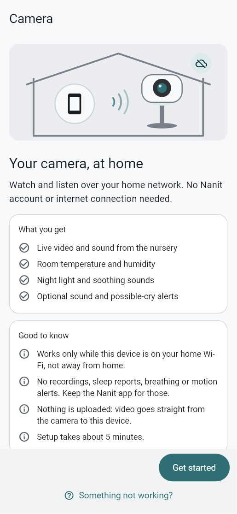

The first screen offers two equal choices:

- **Home network (no account)**: works without the internet. No motion alerts.
- **Sign in with Nanit**: adds motion alerts. Needs the internet about once a week. See
  [Optional: Nanit account mode](#optional-nanit-account-mode).

Nestling remembers your choice. The steps below are for **Home network (no account)**.

### 2. Is your camera already on your Wi-Fi?

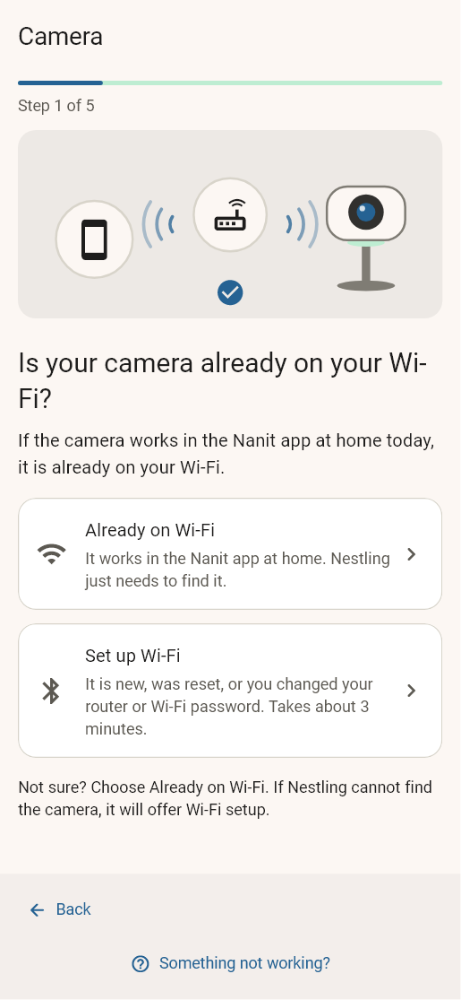

- **Already on Wi-Fi** — the camera works in the Nanit app at home today. Nestling just
  needs to find it. Skip to [step 6](#6-check-this-devices-wi-fi).
- **Set up Wi-Fi** — the camera is new, was reset, or you changed your router or Wi-Fi
  password. Continue with step 3.

**Not sure?** Choose **Already on Wi-Fi**. If Nestling cannot find the camera, it offers
Wi-Fi setup.

### 3. Put the camera in pairing mode

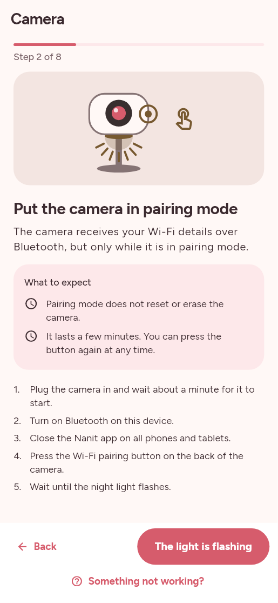

1. Plug the camera in and wait about a minute for it to start.
2. Turn on Bluetooth on this device.
3. Close the Nanit app on all phones and tablets.
4. Press the **Wi-Fi pairing button on the back** of the camera.
5. Wait until the **night light flashes**, then tap **The light is flashing**.

Pairing mode does not reset or erase the camera. It lasts a few minutes; you can press the
button again at any time.

**If this does not work:** if the light does not flash, check the camera has power and
press the button again. If it stops flashing before you finish, press it again.

### 4. Find your camera over Bluetooth

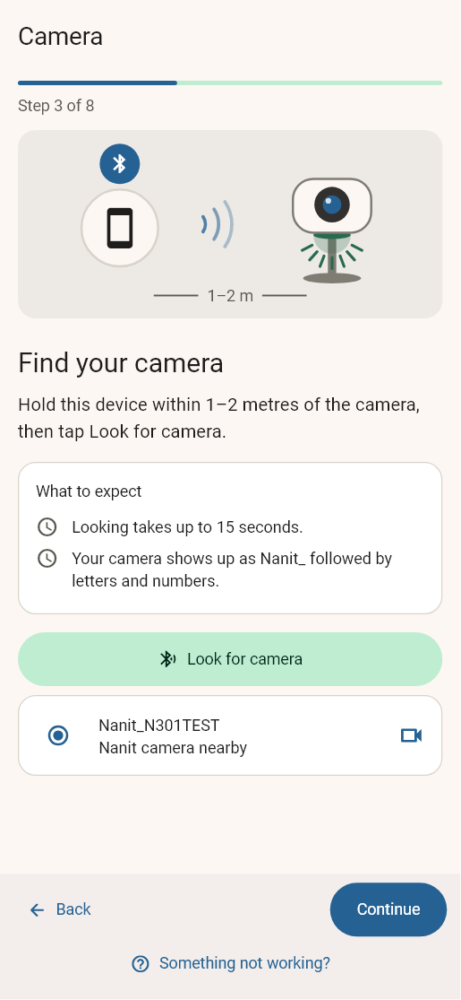

Hold this device within 1–2 metres of the camera and tap **Look for camera**. Looking takes
up to 15 seconds. Your camera shows up as **Nanit_** followed by letters and numbers.
Select it and tap **Continue**.

**If this does not work:**

- *Bluetooth is off* — turn on Bluetooth (on Windows: **Settings → Bluetooth & devices**),
  then tap **Look again**.
- *Nestling cannot use Bluetooth* — on Android open **Settings → Apps → Nestling →
  Permissions** and allow **Nearby devices** (on Android 11 or older, also allow
  **Location** and turn Location on). On Windows, the PC needs Bluetooth Low Energy; if
  there is no Bluetooth switch, the adapter or driver is missing.
- *No camera found nearby* — check the night light is flashing, move closer, close the Nanit
  app on every phone and tablet, and tap **Look again**. You do not need to pair the camera
  in your phone's own Bluetooth settings; if you did, remove it there.

### 5. Enter your home Wi-Fi

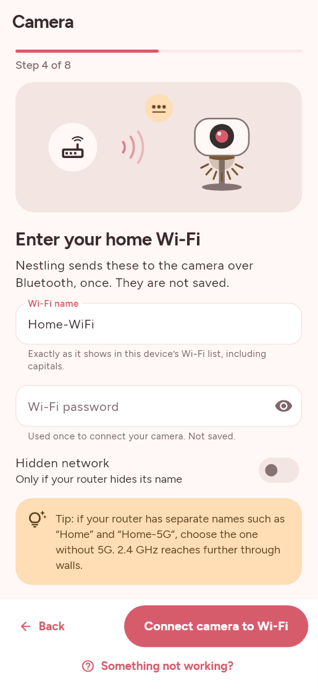

Type the **Wi-Fi name** exactly as it appears in this device's Wi-Fi list (including
capitals), and the **Wi-Fi password**. Turn on **Hidden network** only if your router hides
its name. Tap **Connect camera to Wi-Fi** and keep the camera nearby; it can take up to two
minutes.

Your password is sent once to the camera over Bluetooth and is **not saved**.

**If this does not work:**

- *Check the Wi-Fi name and password* — the name must be 1 to 32 characters and the
  password 8 to 63. Nothing was sent yet; correct them and try again.
- *The camera could not join your Wi-Fi* — check the name and password exactly. Use a home
  network with a password (WPA2); networks with a sign-in web page, like hotel Wi-Fi, do not
  work. If your router is set to "WPA3 only", switch it to "WPA2/WPA3". If you have separate
  2.4 GHz and 5 GHz names, try the 2.4 GHz one. Press the pairing button again, then retry.
- *Wi-Fi setup stopped part-way* — keep this device within 1–2 metres and Nestling open with
  the screen on. Press the pairing button again and look for the camera again.

### 6. Check this device's Wi-Fi

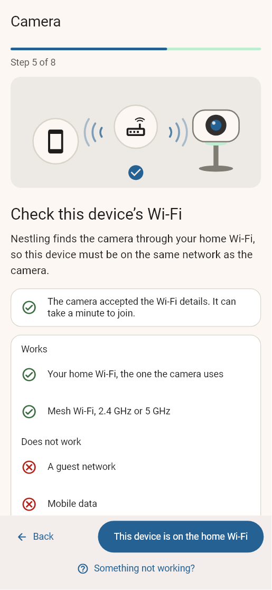

Make sure this phone or PC is on the **same home Wi-Fi** as the camera — not the guest
network, not mobile data, and with any VPN turned off. If you just gave the camera a
different Wi-Fi network, connect this device to it too. Then tap **This device is on the
home Wi-Fi**.

### 7. Find the camera on your network

Tap **Search my network**. It takes up to 15 seconds. Tap your camera when it appears.

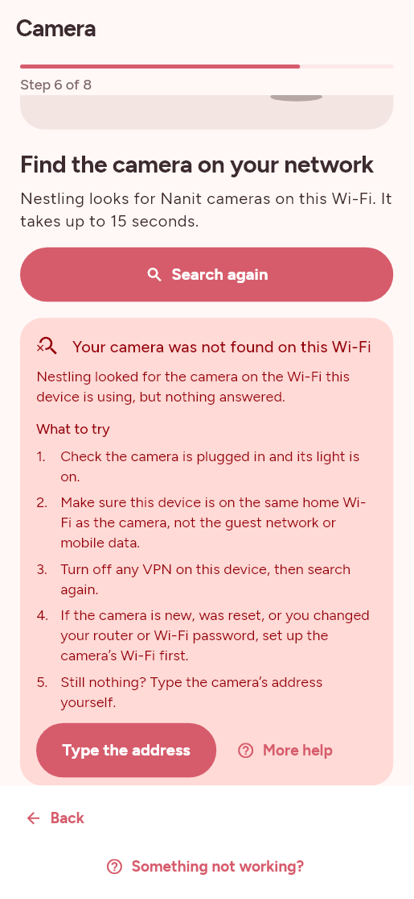

**If this does not work:**

- *Your camera was not found on this Wi-Fi* — check the camera is plugged in and its light
  is on, that this device is on the same home Wi-Fi, and that any VPN is off. If the camera
  is new, was reset, or you changed your router or Wi-Fi password, set up its Wi-Fi first.
- *This device could not search the network* — turn on Wi-Fi and connect to your home
  network. If your phone says the Wi-Fi has no internet, choose to stay connected anyway.
  On Windows, allow Nestling on private networks if asked.
- Still nothing? Open **Enter the address yourself** and type the camera's address (see
  [Finding the camera's address](#finding-the-cameras-address)), then tap **Connect by
  address**.

### 8. Name your camera

Give the camera a name you will recognise, such as *Nursery* or *Grandma's room*, and tap
**Save and connect**. Nestling checks it really is a Nanit camera before saving. Only the
name, address and camera ID are saved on this device — never a password.

**If this does not work:**

- *Nothing answered at that address* — the address may be wrong or out of date, or the
  camera may be off. Tap **Try again**, **Search again**, or check the address in your
  router's device list.
- *Something else is using that address* — a printer, TV or other device answered. Look for
  the device called **Nanit** (or starting with **N3**) in your router and use its address.

### 9. All set

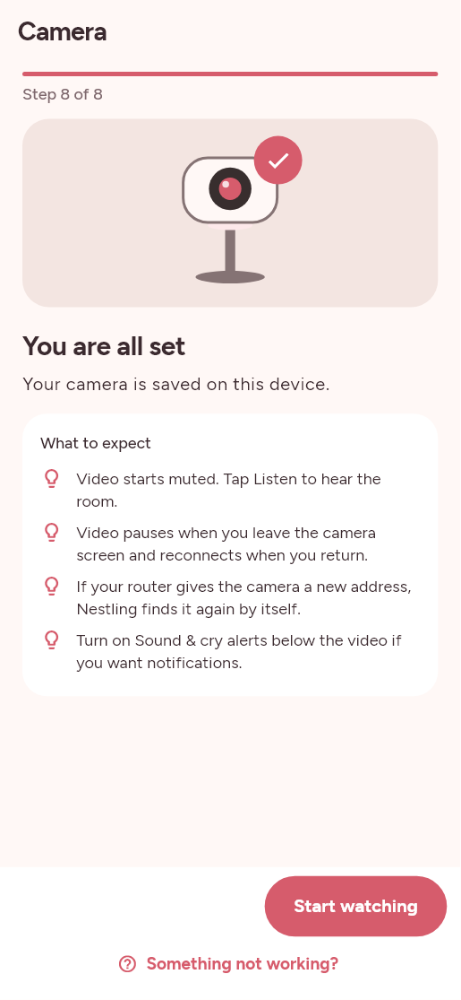

Tap **Start watching**. Good to know:

- Video starts **muted**. Tap **Listen** to hear the room.
- Video pauses when you leave the camera screen and reconnects when you come back.
- If your router gives the camera a new address, Nestling finds it again by itself.

## Finding the camera's address

Nestling usually finds the camera for you. You only need its address if searching does not
work.

The address (called an IP address) is **four numbers separated by dots**, for example
**192.168.1.25**. Home networks use addresses that start with **192.168.**, **10.** or
**172.16** to **172.31**.

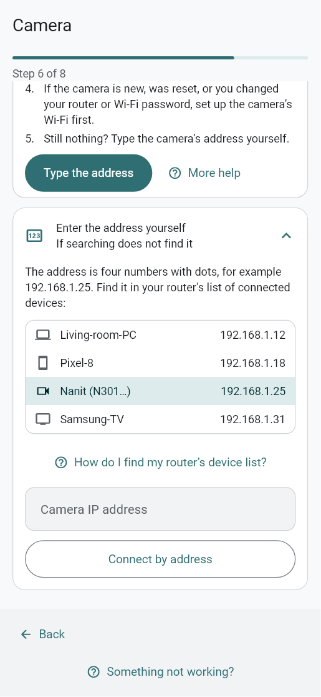

1. Open your router's app (for example the app from your internet provider or mesh system),
   or its web page. That page is often **192.168.1.1** or **192.168.0.1**, and is usually
   printed on a sticker under the router.
2. Find the list of connected devices (often called *Devices*, *Clients* or *Connected
   devices*).
3. Look for a device called **Nanit**, or one whose name starts with **N3**. Its IP address
   is shown next to it.
4. Some versions of the Nanit app also show it in the camera's settings, under network or
   camera information.
5. Type the four numbers and dots exactly, with no spaces and no `http://`.

Example of what a router's device list looks like:

| Device | IP address |
|---|---|
| Living-room-PC | 192.168.1.12 |
| Pixel-8 | 192.168.1.18 |
| **Nanit (N301…)** | **192.168.1.25** |
| Samsung-TV | 192.168.1.31 |

Do not use your internet (public) address from a "what is my IP" website; it will not work.

**Tip:** to stop the address changing after a router restart, "reserve" it in your router.
This setting is often called *DHCP reservation*, *fixed IP* or *static lease*.

## Using the live view

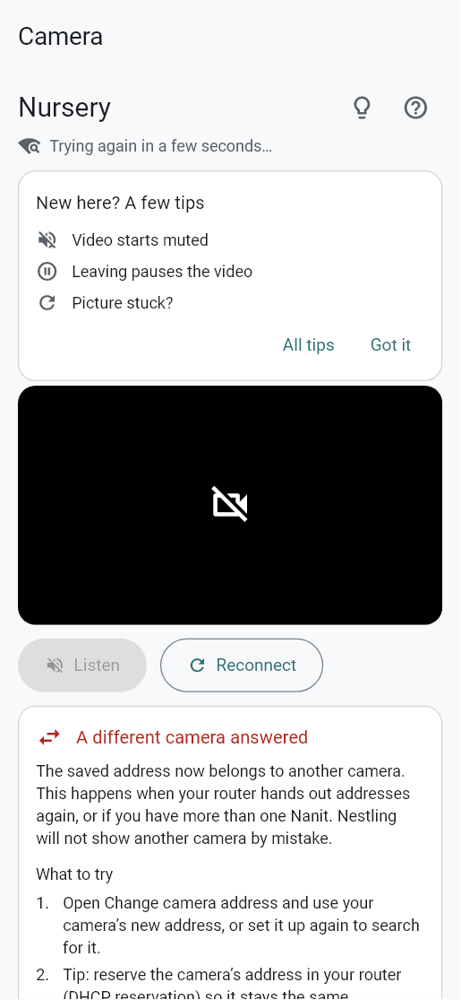

- **Listen / Mute** — video always starts muted so it never wakes anyone by surprise. Tap
  **Listen** to hear the room. Leaving the screen mutes it again.
- **Reconnect** — if the picture is stuck. Nestling also retries by itself every few seconds.
- **Camera sounds** — choose Wind, White noise, Waves or Birds, a volume and a timer (5 to
  60 minutes), then tap **Play sound**. You can change the volume while it plays. It keeps
  playing if you leave the screen or close Nestling, until the timer ends or you tap **Stop
  sound**. Stop the current sound before choosing another track or timer.
- **In the room** — temperature and humidity update every 15 seconds. The **Night light**
  switch turns it on (50%) or off.
- **Change camera address** — if your router gave the camera a new one.
- **Change Wi-Fi** — after a new router or a new Wi-Fi name or password. This runs the
  Bluetooth steps again.
- **Forget this camera** — removes it from Nestling. It does not reset the camera.
- The **lightbulb** button at the top shows tips; the **question mark** opens searchable
  help and questions.

When something goes wrong, the live view shows what happened, why, and what to try, with
buttons such as **Try again** or **Change camera address**.

## Sound and cry alerts

Nestling can keep listening in the background and notify you about loud sounds or possible
crying, even when you leave the camera screen.

1. Under **Sound & cry alerts**, turn on **Monitor in background** and allow notifications.
2. Choose **Sound alerts**, **Cry alerts**, or both, and a **Sound sensitivity**: Low
   (louder sounds only), Normal, or High (quieter sounds too).
3. Keep this device on the home Wi-Fi. On Windows, keep the PC on and awake. On Android,
   tap **Allow background battery use**.

Good to know:

- Each alert repeats at most once a minute.
- General sound alerts pause while the camera's speaker is playing a sound. Cry alerts
  continue.
- A **Camera monitoring interrupted** alert means Nestling lost the camera — not that the
  room is quiet.
- Possible-crying alerts are a best guess and can be wrong.

## Optional: Nanit account mode

On the first setup screen you can choose **Sign in with Nanit**. This signs in to Nanit once
and adds **motion alerts**.

- **Why it needs the internet about once a week:** in account mode the camera only accepts a
  key signed by Nanit, and each key lasts about **7 days**. Nestling renews it by itself
  whenever the device has internet. **Works offline until** on the camera screen shows when
  the current key runs out. If Nestling cannot reach Nanit for a week, video stops until you
  are online again. Nestling keeps you signed in, so you rarely need to sign in again; when
  you do, your email is already filled in.
- Video still travels only over your home Wi-Fi.
- **Motion alerts are simpler than in the Nanit app.** They react to how much the picture
  changes, not to Nanit's cloud analysis of your baby's movement. Shadows, a night light
  switching or a moving mobile can count as motion. Use **Motion sensitivity** (Low ignores
  small changes; High reacts to small ones).
- Your password goes only to Nanit. This device keeps the sign-in key in its secure storage.

If you would rather never need the internet, use home network mode.

**You can set up both.** Under the video, tap **Watch over home network** or **Watch with
Nanit account** to switch, or **Set up home network** / **Sign in with Nanit** to add the
other one. Nestling remembers which one you last used. If the account stops working (for
example the camera is busy with other viewers, or the key ran out), Nestling offers
**Watch over home network**, and the other way round.

## Troubleshooting

Every problem screen in Nestling has a **More help** button, and **Camera help** has a
search box (try words like *password*, *sound* or *address*).

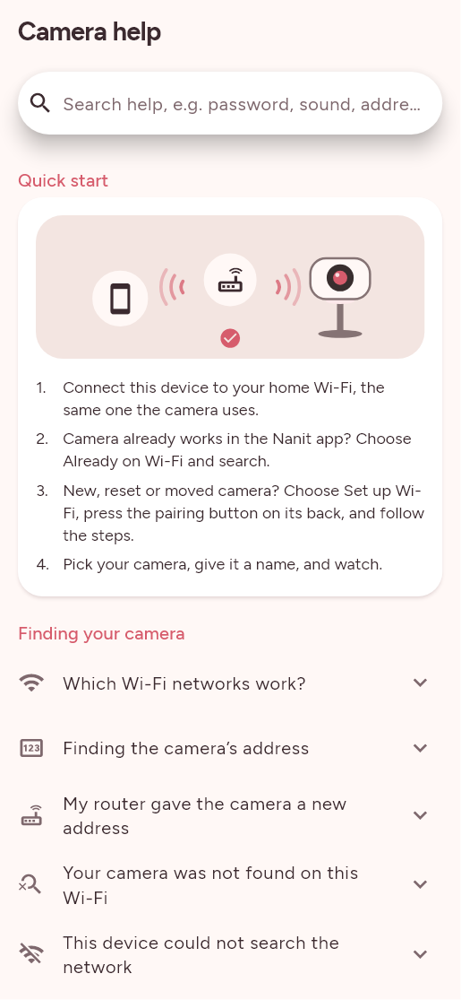

| What you see | What it means | What to do |
|---|---|---|
| Your camera was not found on this Wi-Fi | Nothing answered on this device's network | Check camera power; same home Wi-Fi (not guest or mobile data); VPN off; set up Wi-Fi if the camera is new or reset; or type its address |
| This device could not search the network | Wi-Fi is off or not connected | Connect to home Wi-Fi; stay connected even if it says "no internet"; on Windows allow private networks |
| That does not look like a home-network address | The address is mistyped or public | Four numbers with dots, e.g. 192.168.1.25; use the router's device list |
| Nothing answered at that address | Wrong or old address, or camera off | Check the numbers; look the address up again; or search instead |
| Something else is using that address | A different device answered | Use the device called Nanit / N3… in your router |
| A different camera answered | Your router reassigned addresses, or you have two Nanits | **Change camera address**; reserve the address in your router |
| Cannot reach the camera right now | No answer from the camera; Nestling keeps retrying | Check power and Wi-Fi; VPN off; after a router restart use **Change camera address**; after a Wi-Fi change use **Change Wi-Fi** |
| The camera answered, but video did not start | The camera is busy, often just after starting | Wait 30 seconds and tap **Reconnect**; if it repeats, unplug the camera for 10 seconds |
| Video stopped | The connection dropped | Nestling reconnects by itself; if it happens often, improve Wi-Fi near the camera or this device |
| Temperature and humidity are unavailable | Readings did not arrive; video still works | Wait — it retries every 15 seconds; tap **Reconnect** if it lasts minutes |
| I can see video but cannot hear anything | Video starts muted | Tap **Listen**; turn up media volume; check headphones / Windows sound output |
| The camera did not send video | A firewall or VPN on this device is blocking it | Windows: allow Nestling on private networks and set your Wi-Fi to Private; phone: turn off VPN/firewall apps |
| The camera is busy with other viewers (error 403) | The camera only streams to a few apps at once | Close the Nanit app or Nestling on other devices; wait a minute; **Try again** |
| This device is not on the camera's network | Video cannot reach this device | Connect to home Wi-Fi; VPN off |
| Bluetooth is off | Needed for Wi-Fi setup only | Turn Bluetooth on; **Look again** |
| Nestling cannot use Bluetooth | Permission denied or no Bluetooth adapter | Android: allow **Nearby devices** (and Location on Android 11 or older); Windows: check Bluetooth & devices |
| No camera found nearby | No camera in pairing mode answered | Check the flashing night light; press the pairing button again; move within 1–2 m; close the Nanit app |
| That device is not a camera in setup mode | Pairing mode may have ended | Press the pairing button again; pick the device starting with Nanit_ |
| Check the Wi-Fi name and password | Name or password too long or too short | Name 1–32 characters, password 8–63 |
| The camera could not join your Wi-Fi | Usually a typo or unsupported network | Check exact name/password; WPA2 network; try the 2.4 GHz name; press the pairing button and retry |
| Wi-Fi setup stopped part-way | Bluetooth connection ended | Stay within 1–2 m; keep Nestling open; press the pairing button and try again |
| Your camera key needs renewing (account mode) | The weekly Nanit key expired or you were signed out | Get online and tap **Sign in again**; or use home network mode |
| Could not reach Nanit to renew the camera key (account mode) | No internet right now | Video keeps working until "Works offline until"; try again when online |
| The camera's identity changed (account mode) | The camera was reset or replaced | Tap **Pick the camera again** |
| My router gave the camera a new address | Routers can change addresses after a restart | Nestling searches by itself; otherwise **Change camera address**; reserve the address |

## Questions people ask

**What does home network mode do?**
It shows live video and sound from your Nanit camera, the room temperature and humidity,
the night light, soothing sounds, and optional sound and cry alerts. Everything travels over
your own Wi-Fi, straight from the camera to this device.

**What does it not do, compared with the Nanit app?**
No watching away from home, no recordings or video history, no sleep reports, no breathing
monitoring, no motion alerts and no talking through the camera. Keep the Nanit app for those.

**Do I need the internet?**
Not in home network mode. Once set up, it works with the internet switched off. Nanit
account mode is different: it needs the internet for a moment about once a week.

**Why does account mode need the internet about once a week?**
In account mode the camera only accepts a key signed by Nanit, and each key lasts about 7
days. Nestling renews it by itself whenever it can. If it cannot reach Nanit for a week,
video stops until you are online again.

**Does my video go to the cloud?**
Nestling does not upload your video or sound anywhere. It goes from the camera to this
device over your Wi-Fi. The camera itself may still talk to Nanit if it has internet;
Nestling does not change that. If you want the camera never to reach the internet, block it
in your router.

**Is my Wi-Fi password saved?**
No. During setup it is sent once to the camera over Bluetooth and then forgotten.

**Can I keep using the Nanit app?**
Yes. Nestling does not change your Nanit account or subscription. Close the Nanit app while
you set up the camera's Wi-Fi, and remember the camera only streams to a few apps at once.

**Can I set up both modes?**
Yes. Set up the home network and sign in with Nanit, then switch between them under the
video. If one stops working, Nestling offers the other.

**Can two phones watch at the same time?**
Yes, if both are on the home Wi-Fi. Set up the camera in Nestling on each device. The camera
limits how many apps can watch at once.

**Which cameras work?**
Home network mode has been tested on the Nanit Pro camera with firmware 6.58.615. Other
models or firmware may not work or may behave differently.

**Does it work with mesh Wi-Fi, 5 GHz or a VPN?**
Mesh Wi-Fi works. 2.4 GHz and 5 GHz both work as long as they are the same home network.
Guest networks and VPNs usually block it.

**Does it use a lot of battery or data?**
Live video uses Wi-Fi only, never mobile data, and pauses when you leave the camera screen.
Background alerts use some battery because Nestling keeps listening.

**Does pairing mode or “Forget this camera” reset my camera?**
No. Pairing mode only lets the camera receive new Wi-Fi details, and Forget only removes it
from Nestling.

**Can I rely on it as a baby monitor?**
Treat it as a convenience, not a safety device. Video and alerts can fail or arrive late,
for example if the Wi-Fi drops. Always check on your baby yourself.

---

Nestling is not made by or affiliated with Nanit. Nanit is a trademark of its owner.
